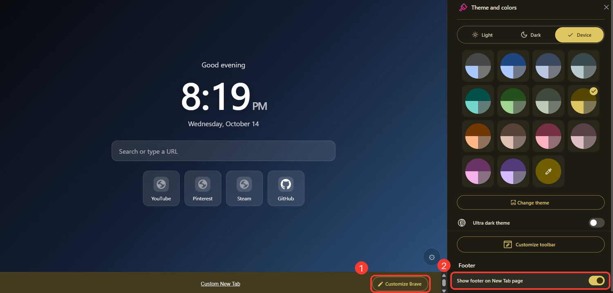

# Custom New Tab

A fast, private and fully customizable new-tab page for Brave, Chrome and Edge.
Video and image wallpapers, draggable widgets, a now-playing audio widget, a real sound-reactive visualizer,
bookmarks dock, scenes, themes and more. No account, no tracking, no heavy framework (about 100 KB).

> Replace `YOUR-USERNAME` / `YOUR-REPO` below after you create the repository.

## Features

| Area | What you get |
|---|---|
| Wallpapers | Upload your own image / GIF / video (looping), built-in library window with live hover preview, slideshow with your chosen wallpapers, per-wallpaper brightness/dim/blur settings, day/night auto-switch, vignette, focus point, parallax |
| Widgets | Clock (digital + analog), date, greeting, search, shortcuts, notes, to-do, weather, focus timer, calendar, countdown, daily quote, bookmarks, Google apps launcher |
| Audio | Now-playing players (bar, pill, circle, card, mini) for any tab playing audio; visualizer (bars, mirror, dots, wave, radial) that reacts to real sound |
| Layout | Drag, resize and rotate any widget; snap to grid; zen mode with a list of what hides; presets (Minimal / Balanced / Full) |
| Look | Themes, frosted / glossy / clear / OLED-black glass with adjustable tint, accent color, built-in fonts or any Google Font, custom CSS |
| Productivity | Command palette (`Ctrl+K`), bang search (`!yt`, `!gh`, `!w`, `!g`, `!r`), scenes (save whole looks), full backup with wallpapers |
| Open animation | Screen-fill loader with the site logo when you open a shortcut or bookmark |
| Performance | Instant first paint, Lite mode (no blur, still wallpaper), video pauses when the tab is hidden |

## What's new in v2.10

- **Glass tint**: color the glass cards and search bar (Settings > Look > Glass tint color / Tint strength).
- **Google apps widget**: Gmail, Drive, Classroom, Docs, Meet and more in a dropdown or grid, separate from your normal shortcuts.

v2.9 highlights:

- **Zen mode you control**: pick what hides (even the clock). The search bar stays while you type; press `/` to search.
- **Google Fonts**: use any font name for all text or only the clock.
- **Bookmarks dropdown**: a small button that opens a searchable list, so many bookmarks no longer take space.
- **Full backup**: settings and uploaded wallpapers in one file.

Earlier highlights:

- **Per-wallpaper settings**: every wallpaper remembers its own dim, brightness, blur and other adjustments, so slideshows always look right.
- **Pick your slideshow wallpapers** (and choose shuffle or in-order).
- Open animation that plays for a fixed time while the site loads in the background (v2.7).
- Real sound-reactive visualizer, bookmarks dock, compact wallpaper library window (v2.5).

Full history in [CHANGELOG.md](CHANGELOG.md).

## Install (Brave / Chrome / Edge)

1. Go to the [Releases page](https://github.com/YOUR-USERNAME/YOUR-REPO/releases) and download `custom-newtab-extension.zip`
   (or click **Code > Download ZIP** and use the `extension` folder).
2. Extract the zip to a folder you will keep (do not delete it later, the extension runs from there).
3. Open `brave://extensions` (Chrome: `chrome://extensions`, Edge: `edge://extensions`).
4. Turn on **Developer mode** (top-right).
5. Click **Load unpacked** and select the extracted folder, the one that contains `manifest.json`.
6. Turn off any other new-tab extension (only one can control the new tab), then press `Ctrl+T`.
7. See a grey bar at the bottom of the new tab? That is the browser's own footer. [Here is how to hide it](#hide-the-grey-bar-at-the-bottom).

Brave and Chrome may show a "developer mode extensions" notice on startup. That is normal for extensions installed this way.

## First two minutes

1. Click the **gear** (bottom-right).
2. **Wallpapers** tab > *Upload your own* and pick an image or video, or open *Choose from library*.
3. **Widgets** tab > pick a preset (Minimal / Balanced / Full) and switch on the widgets you want.
4. **Widgets > Layout > Move & resize**: drag to move, drag the square corner to resize, the round corner to rotate,
   double-click to reset, arrow keys to nudge, `Esc` to finish.
5. **Settings** tab > themes, glass style, accent color. Use the search box at the top if you cannot find something.

## Hide the grey bar at the bottom

After installing, Brave/Chrome may show a grey bar at the bottom of the new tab with a **"Custom New Tab"** link and a
**Customize Brave** button. This is the browser's own footer that appears for every extension new tab. It is not part of this
extension and it is safe to turn off:

1. Click **Customize Brave** in the bottom bar (marked **1** in the screenshot).
2. In the **Theme and colors** panel, scroll down to **Footer**.
3. Turn off **Show footer on New Tab page** (marked **2**).



Chrome and Edge show the same footer with slightly different names ("Customize Chrome" / "Customize Edge").
You can also try right-clicking the bar and choosing **Hide footer on New Tab page**. You only have to do this once.

## Slideshow and per-wallpaper settings

- **Settings: Wallpapers > Auto change > Slideshow** picks how often the wallpaper changes (each new tab, 5 / 15 / 60 min).
  **Slideshow wallpapers** opens a small window where you tick exactly which wallpapers take part. **Slideshow order** is shuffle or in order.
- **Wallpapers > Adjust > Save per wallpaper** (on by default): each wallpaper keeps its own dim, brightness, saturation, blur, fit, focus,
  vignette, tint and video settings. Adjust a wallpaper once and it looks the same every time the slideshow shows it.
  *Reset this wallpaper* returns it to the defaults; *Use for all* makes the current look the default for every wallpaper.

## Zen mode, fonts and backups

- **Zen mode** (`Z`): **Widgets > Arrange > Choose what zen mode hides** lets you tick every part that disappears (clock, date, greeting,
  search, shortcuts, notes, to-do, weather, timer, calendar, countdown, quote, bookmarks, audio players, visualizers, settings button).
  Move the mouse to peek. Press `/` to search; the search bar stays visible while you type.
- **Google Fonts**: **Settings > Look > Google font** takes any family name from [fonts.google.com](https://fonts.google.com)
  (for example `Poppins` or `Orbitron`), separately for all text and for the clock. Needs internet; leave empty for the built-in fonts.
- **Bookmarks**: **Widgets > Bookmarks > Show as** is *Dropdown* (a small button that opens a searchable list) or *Always open*.
- **Backup** (**Settings > Backup**): *Settings only* is a small `.json` file. *Full backup* creates one `.ntbk` file with your settings, scenes,
  notes, to-dos, per-wallpaper settings **and your uploaded wallpapers**. Import it on any computer to restore everything.

## Google apps widget

**Widgets > Show > Google apps** adds a small button that opens a launcher with up to 24 Google apps (Gmail, Drive, Docs, Sheets, Slides, Forms,
Classroom, Meet, Calendar, Photos, Maps, YouTube, Translate, Keep, Contacts, Chat, Gemini, Sites, Earth, News, Scholar, Play Store, Search, Colab).
In **Widgets > Google apps** you can choose which apps appear, the icon size, columns, dropdown or always open, and the **account number**
(0 = first signed-in Google account, 1 = second, and so on). `Ctrl+K` also finds these apps by name. The icons are simple built-in glyphs, not Google logos.

## Keyboard shortcuts

| Key | Action |
|---|---|
| `Ctrl+K` / `Cmd+K` | Command palette (shortcuts, bookmarks, commands, `!yt cats` style searches) |
| `/` | Focus the search bar |
| `Z` | Toggle zen mode (move the mouse to peek) |
| `Esc` | Close panels, exit edit mode, cancel the open animation |

## Add your own wallpapers to the library

1. Copy your files into `extension/wallpapers/` (for example `blackhole.mp4` and a poster image `blackhole.jpg`).
2. Open `extension/app.js` and find the `LIB` array near the top. Add a line:
   ```js
   {n:"Black hole",t:"video",s:"wallpapers/blackhole.mp4",p:"wallpapers/blackhole.jpg"},
   {n:"Mountains",t:"img",s:"wallpapers/mountains.jpg"},
   ```
3. Save, open `brave://extensions` and click the reload icon on the extension.

Only add wallpapers you own or have permission to share. This repository ships no third-party wallpapers.

## Audio widgets and visualizer

- **Widgets > Audio players > Add audio widget**, then play something in another tab (YouTube, SoundCloud, YouTube Music, Spotify Web...).
  Click the artwork or title to jump to that tab.
- Play / pause / seek work on any site. Next / previous work on YouTube, YouTube Music, Spotify Web and SoundCloud; elsewhere they skip 10 s.
- **Visualizer > Source**
  - *Tab audio*: reads the real audio of the playing tab. Some sites use protected audio and cannot be read.
  - *Share audio*: the browser asks you to share a tab (tick "Share tab audio"); works for any site, must be restarted per tab.
  - *Demo animation*: a simple animation that moves while music plays.

## Permissions explained

| Permission | Why |
|---|---|
| `favicon` | Show real site icons on shortcuts and bookmarks |
| `tabs` | Find which tab plays audio; open a site in a background tab during the open animation |
| `scripting` + all-sites access | Read title, artwork, progress and audio of the playing tab; send play/pause/seek commands. Used only when you add audio widgets or the visualizer |
| `bookmarks` | Bookmarks widget and search in the command palette |
| `api.open-meteo.com` | Optional weather widget |

Nothing is sent to the author. See [PRIVACY.md](PRIVACY.md).

## Web version (no install)

A single-file web version lives in `docs/index.html` and can be hosted with GitHub Pages:
[https://YOUR-USERNAME.github.io/YOUR-REPO/](https://YOUR-USERNAME.github.io/YOUR-REPO/).
Wallpapers, widgets, scenes and themes work. Audio widgets, tab audio, the bookmarks widget (it shows demo bookmarks), real weather
and the background-tab open animation need the extension.

## Updating

The version you have is shown on the extension card in `brave://extensions`. The newest version is on the
[Releases page](https://github.com/YOUR-USERNAME/YOUR-REPO/releases).

**Installed from a zip**

1. Optional safety copy: open the settings (gear) > **Settings** tab > **Backup > Full backup > Export** (includes your wallpapers).
2. Download the new `custom-newtab-extension.zip` from the Releases page.
3. Extract it into the **same folder** as before and choose **Replace the files** when asked.
4. Open `brave://extensions`, click the **reload** icon on the extension card, then open a new tab.

**Cloned with git**: run `git pull`, then click the reload icon on the extension card.

**Keep the folder in the same place.** The browser links an unpacked extension's saved data (settings and uploaded wallpapers)
to the folder it was loaded from. Loading it from a different folder starts fresh, so if you must move it, export your settings first
and import them after. Use **Full backup** if you also want your uploaded wallpapers to come along (the settings-only export does not include them).

## Troubleshooting

| Problem | Fix |
|---|---|
| Grey bar with "Customize Brave" at the bottom | Browser footer, see [Hide the grey bar](#hide-the-grey-bar-at-the-bottom) |
| Blank page / nothing shows | `brave://extensions` > *Errors* button on the card, then open an issue with the message |
| Old new-tab page still shows | Turn off other new-tab extensions, then restart the browser |
| Extension disappeared | The folder you loaded was moved or deleted. Load it again |
| Visualizer does not move | Set Source to *Share audio* (the site may use protected audio) |
| Slow on an old PC | Settings > Look > *Lite mode* |
| Wallpaper video does not play | Use MP4 (H.264) or WebM; very large files are heavy, try 1080p |

## Contributing

Issues and pull requests are welcome. The extension is plain HTML, CSS and JavaScript with no build step.
To test changes, edit files in `extension/` and press reload on the extension card.

## License

[MIT](LICENSE)
